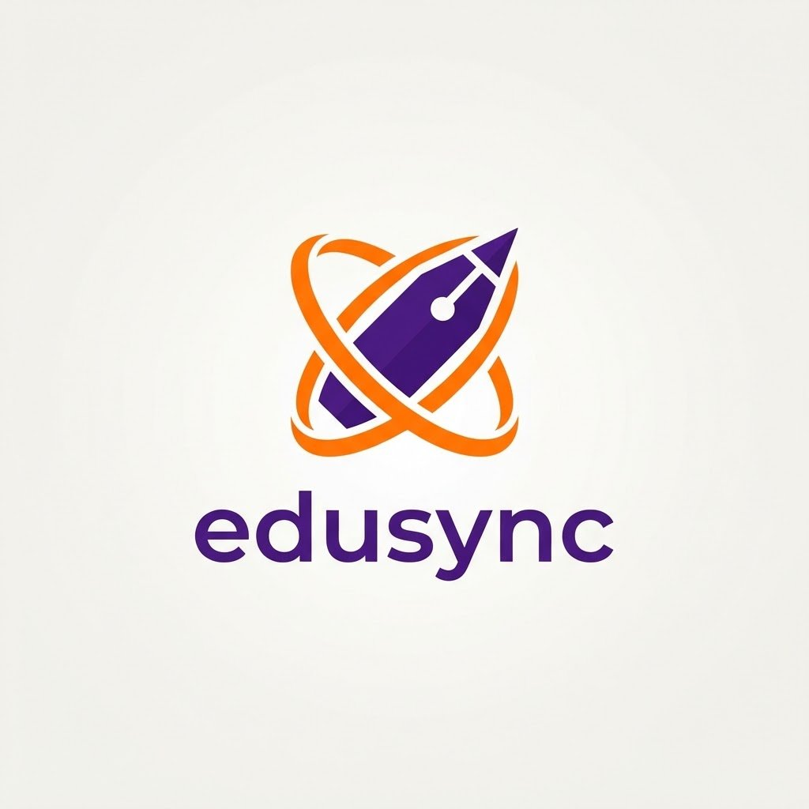

<div align="center">



# EduSync

**Smart Classroom Management for Filipino Schools**

[](https://github.com/Kioian89/edusync/releases/latest)
[](https://github.com/Kioian89/edusync/actions/workflows/release.yml)
[](https://android.com)
[](https://flutter.dev)
[](https://firebase.google.com)
[](./LICENSE)

[📲 Download APK](https://github.com/Kioian89/edusync/releases/latest) · [🐛 Report Bug](https://github.com/Kioian89/edusync/issues/new?template=bug_report.md) · [💡 Request Feature](https://github.com/Kioian89/edusync/issues/new?template=feature_request.md)

</div>

---

## 📖 About EduSync

**EduSync** is a free, open-source **Android mobile app** built with Flutter and Firebase, designed specifically for teachers and students in Philippine schools.

It streamlines the entire classroom experience — from class enrollment via QR code scan, to AI-powered quiz generation, to real-time grade tracking — all in one clean, offline-capable **Android app** installed directly on your phone.

> **Built for teachers who want less paperwork and more teaching.**

---

## ✨ Features

### 👩‍🏫 For Teachers
| Feature | Description |
|---|---|
| 📋 **Class Management** | Create multiple class sections with QR codes for instant student enrollment |
| 📝 **Activity Builder** | Create quizzes, assignments, essays, and projects with deadlines and point values |
| 🤖 **Lodix AI Assistant** | Generate quiz questions, lesson outlines, and rubrics from any topic using Lodix AI |
| 📊 **Grade Dashboard** | View all student submissions, grade them, and track class progress at a glance |
| 📢 **Announcements** | Post class-wide announcements that students see instantly |
| 📸 **Editable Profile** | Upload a profile photo to personalize your teacher account |

### 🎓 For Students
| Feature | Description |
|---|---|
| 📷 **QR Enrollment** | Scan teacher's QR code to instantly join any class |
| 📚 **Multi-Class View** | Enroll in multiple subjects and see all tasks in one dashboard |
| 📬 **Submit Activities** | Upload answers and files for teacher review and grading |
| 👥 **Classmates Status** | See your classmates' progress and completion status across all subjects |
| 🏆 **Grades View** | Track your own grades and feedback per activity |
| 📸 **Editable Profile** | Add a profile photo to your student account |

### 🔧 Technical Highlights
- 📱 **Android APK** — Native Android experience via Flutter
- 🔥 **Firebase** — Real-time Firestore database, Authentication, Cloud Storage
- 🤖 **Lodix Universal AI Engine** — Multi-provider AI (Google Gemini, Groq, OpenAI, Claude, DeepSeek) with automatic key detection
- 📡 **Shorebird** — Over-the-air (OTA) code push for instant updates without reinstalling
- 🔔 **FCM Push Notifications** — Instant alerts for new activities and grades
- 📷 **QR Code Scanner** — Built-in camera scanner for instant class enrollment
- 🎨 **Royal Purple Theme** — Clean, modern Material 3 UI
- 📶 **Offline Cache** — Works with limited connectivity using local SharedPreferences cache

---

## 📲 Download & Install

### Latest Release — Android APK
👉 **[Download edusync.apk](https://github.com/Kioian89/edusync/releases/latest)**

1. On your **Android phone**, open the link above and download `edusync.apk`
2. Go to **Settings → Security** (or Privacy) → enable **"Install unknown apps"**
3. Open the downloaded APK file and tap **Install**
4. Launch **EduSync** and register as a **Teacher** or **Student**

> ⚠️ **Android only** — requires **Android 6.0 (API 23) or higher**
> iOS is not currently supported.

---

## 🚀 Getting Started (Development)

### Requirements
- [Flutter SDK](https://flutter.dev/docs/get-started/install) (see `pubspec.yaml` for version)
- **Android Studio** or VS Code with Flutter extension
- An **Android device** or emulator (API 23+)
- A Firebase project with Firestore, Auth, Storage, and Messaging enabled

### Setup

```bash
# 1. Clone the repo
git clone https://github.com/Kioian89/edusync.git
cd edusync

# 2. Install dependencies
flutter pub get

# 3. Configure Firebase
# Replace android/app/google-services.json with your own Firebase config

# 4. Run on a connected Android device or emulator
flutter run
```

### Firestore Security Rules
Deploy the included rules to your Firebase project:
```bash
firebase deploy --only firestore:rules
```
Or paste the contents of [`firestore.rules`](./firestore.rules) in the Firebase Console.

### Run Tests
```bash
flutter test          # Run all tests
flutter analyze       # Static analysis (must show 0 issues)
```

---

## 🏗️ Project Structure

```
lib/
├── models/           # Data models (User, ClassGroup, Activity, Submission)
├── providers/        # State management (AuthProvider, ActivityProvider, GeminiAssistantProvider)
├── screens/
│   ├── teacher/      # Teacher-specific screens
│   └── student/      # Student-specific screens
├── services/         # Firebase, Gemini AI, and notification services
├── theme/            # App theme and color constants
└── widgets/          # Shared reusable widgets
```

---

## 🤝 Contributing

We welcome contributions! Please read our [Contributing Guide](./CONTRIBUTING.md) and [Code of Conduct](./CODE_OF_CONDUCT.md) before submitting a pull request.

```bash
# Fork → Branch → Code → Test → PR
git checkout -b feat/your-feature-name
flutter test && flutter analyze
git commit -m "feat(scope): description"
```

See [COMMUNITY_STANDARDS.md](./COMMUNITY_STANDARDS.md) for full guidelines.

---

## 🔒 Security

Found a security issue? Please **do not** open a public issue. Read our [Security Policy](./SECURITY.md) for responsible disclosure instructions.

---

## 📄 License

This project is licensed under the **MIT License** — see the [LICENSE](./LICENSE) file for details.

---

## 👨‍💻 About the Developer

**EduSync** was created to solve a real problem: teachers in the Philippines spending more time on paperwork than on teaching. It's built with love for Filipino educators and students. 🇵🇭

---

<div align="center">

Made with ❤️ using Flutter & Firebase

⭐ **Star this repo if EduSync helps your classroom!** ⭐

</div>
